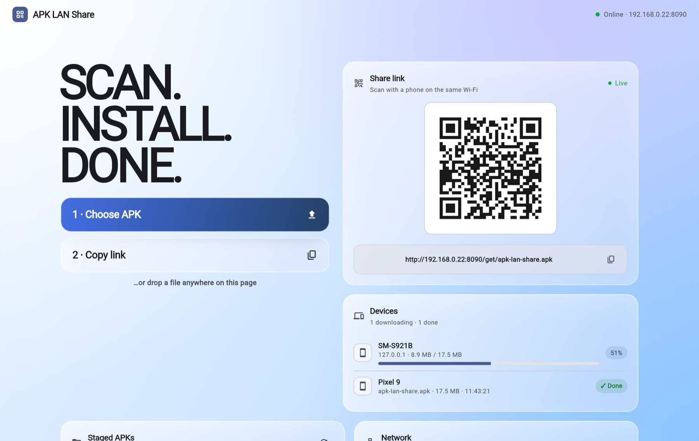
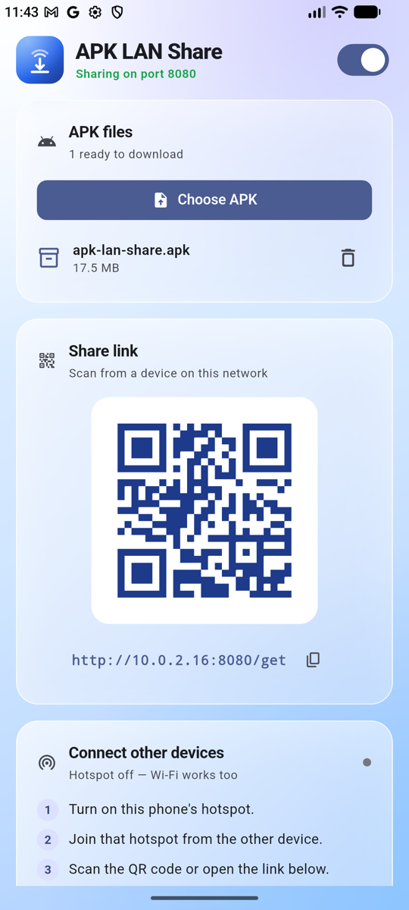
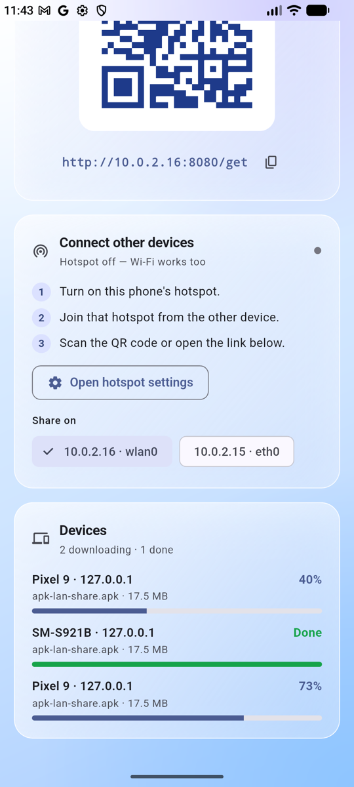
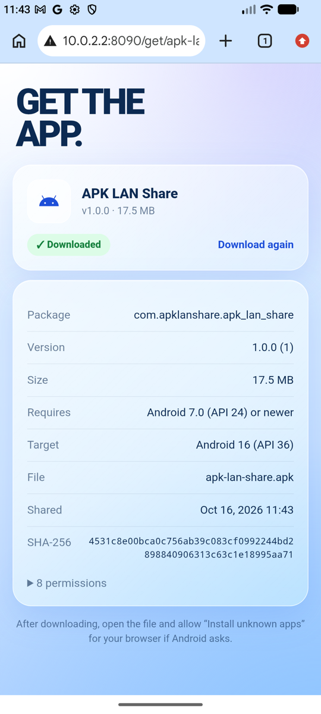

<p align="center">
  
</p>

<h1 align="center">APK LAN Share</h1>

<p align="center">
Share Android <code>.apk</code> files over Wi-Fi or a phone hotspot. Drop an APK on a dashboard, or pick one in the Android app, scan the QR code, download. No cloud, no cable.
</p>

## Screenshots

<table>
  <tr>
    <td align="center" width="50%"><b>Web dashboard</b><br></td>
    <td align="center" width="25%"><b>Android app</b><br></td>
    <td align="center" width="25%"><b>Android app: devices</b><br></td>
  </tr>
  <tr>
    <td align="center" colspan="3"><b>Second device (usage)</b><br>Another phone opens the link and sees the APK details and download button.<br></td>
  </tr>
</table>

## Two ways to run

| | Host | Other devices |
|---|---|---|
| **Web dashboard** | Computer (Flutter Web + Dart server) | Phones on the same Wi-Fi |
| **Android app** | The phone itself (embedded server) | Any device joined to the phone's hotspot or Wi-Fi |

```
 Browser dashboard (Flutter Web)          Companion server (Dart, shelf)
 drop APK ──── POST /upload ───────────▶  stages file in backend/public/
 QR + live downloads ◀── GET /info ────   parses APK metadata, tracks downloads
                                                    │ LAN
                          Phone scans QR ──▶  GET /get/<file>.apk  (details page)
                                              GET /download/<file>.apk
```

Flutter Web cannot open sockets or serve files, so a small Dart server does the networking and the dashboard drives it.

## Features

- Drag and drop an APK anywhere on the dashboard, or browse. Real upload progress.
- Multiple staged APKs: list, delete, range select, download as a batch.
- QR code per APK. Phone opens a download page with app name, icon, package, version, SDK levels, permissions and SHA-256.
- Live device downloads: see which phone downloads what, with progress. Resumable (HTTP Range).
- Auto-detected LAN IP (prefers `192.168.x`, skips Docker/VM adapters). Override in the Network card.
- Files persist across restarts.
- Android app: host the share server on the phone and serve over its hotspot.

## Android app

Prebuilt APKs: [DOWNLOAD.md](DOWNLOAD.md).

The app runs the same server inside the phone, so no computer is needed.

1. Open the app, tap **Choose APK** and pick one or more `.apk` files.
2. Turn on the phone hotspot (**Open hotspot settings** jumps there).
3. Join that hotspot from the other device, then scan the QR code or open the link shown (`http://<hotspot-ip>:8080/get`).

The app detects the hotspot address (for example `192.168.43.1`) and lets you switch address if the phone has several. A foreground notification keeps the server alive while you switch apps. Live download progress per device is shown in the app.

Build and install (needs a connected device or emulator, JDK 17):

```bash
flutter build apk --release        # build/app/outputs/flutter-apk/app-release.apk
flutter run -d <device-id>         # debug run
```

Same code base: `lib/main.dart` starts the web dashboard on web and `lib/android/` on Android. Both reuse `backend/` as a Dart package.

## Quick start (web dashboard)

```bash
git clone <repo-url> apk-lan-share
cd apk-lan-share
./scripts/apk-share.sh start     # builds on first run, opens the dashboard
./scripts/apk-share.sh stop
```

Needs Flutter 3.24+ and a shared Wi-Fi. Full steps and the Apple Shortcuts one-click setup: [GETTING_STARTED.md](GETTING_STARTED.md).

## Server API

| Method | Route | Description |
|---|---|---|
| `GET` | `/info` | LAN IP, port, storage dir, staged files, recent downloads |
| `POST` | `/upload?name=<file>.apk` | Raw body staged to disk (4 GB cap) |
| `DELETE` | `/files/<file>.apk` | Remove a staged APK |
| `GET` / `HEAD` | `/download/<file>.apk` | Stream APK as attachment, supports `Range` |
| `GET` | `/get`, `/get/<file>.apk` | Phone-friendly list / detail page |
| `GET` | `/icon/<file>.apk` | App icon extracted from the APK |
| `GET` | `/api/downloads` | Download records (who, what, progress) |
| `GET` | `/` | Built dashboard (when served with UI) |
| `OPTIONS` | `*` | CORS preflight (`Access-Control-Allow-Origin: *`) |

Server rules: filename is basename only, `[A-Za-z0-9._-]`, `.apk` required, `../` rejected. Uploads stream to a `.part` file, renamed after a complete write. Downloads send `nosniff` and `no-store`.

## Server options

```
dart run bin/server.dart [options]    (run inside backend/)
  --port <n>     port (default 8080)
  --host <addr>  interface (default 0.0.0.0 = whole LAN; 127.0.0.1 = this machine only)
  --dir <path>   staging directory (default ./public)
  --ui <path>    built Flutter web dir (default: auto-detects ../build/web)
  --no-ui        API only
  -h, --help
```

Check it works:

```bash
curl http://127.0.0.1:8080/info
curl -X POST "http://127.0.0.1:8080/upload?name=app.apk" --data-binary @app.apk
curl -OJ http://127.0.0.1:8080/download/app.apk
```

## Security

LAN tool, no authentication. Anyone on your Wi-Fi who knows the URL can upload, download and delete. Use trusted networks, or bind `--host 127.0.0.1` to keep it local. Stop the server when done.

## Docs

- [DOWNLOAD.md](DOWNLOAD.md): prebuilt Android APKs per CPU architecture, checksums
- [GETTING_STARTED.md](GETTING_STARTED.md): install, run, Apple Shortcuts, troubleshooting
- [CONTRIBUTING.md](CONTRIBUTING.md): project layout, dev mode, Android Studio, tests
